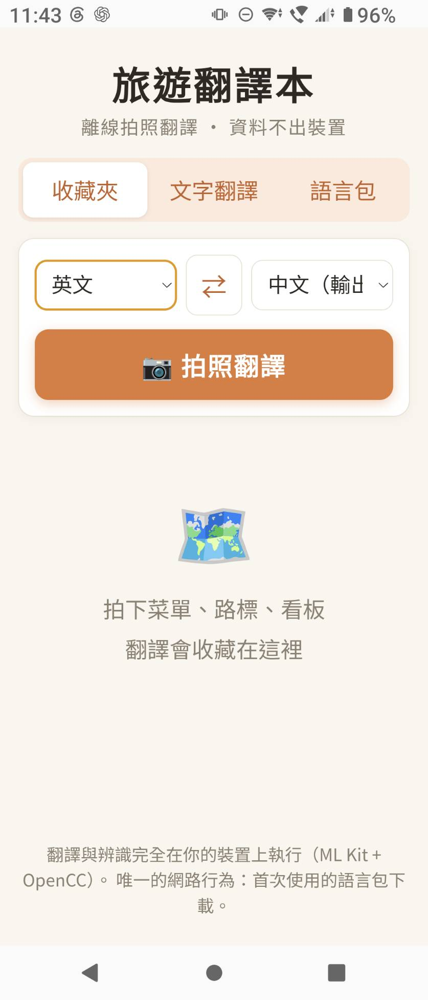
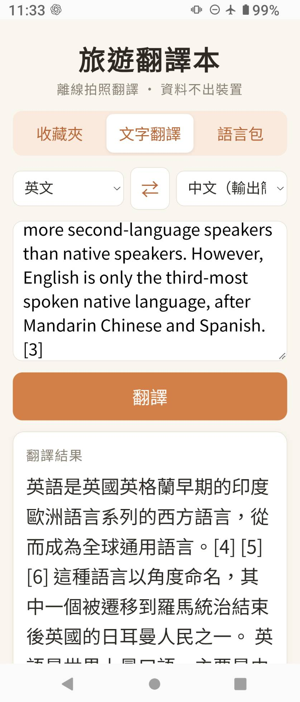
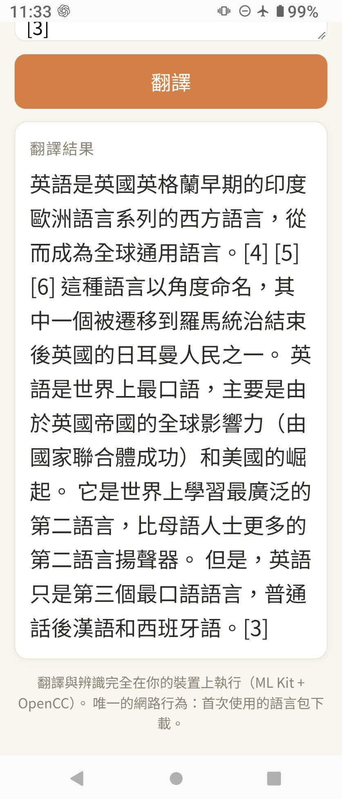
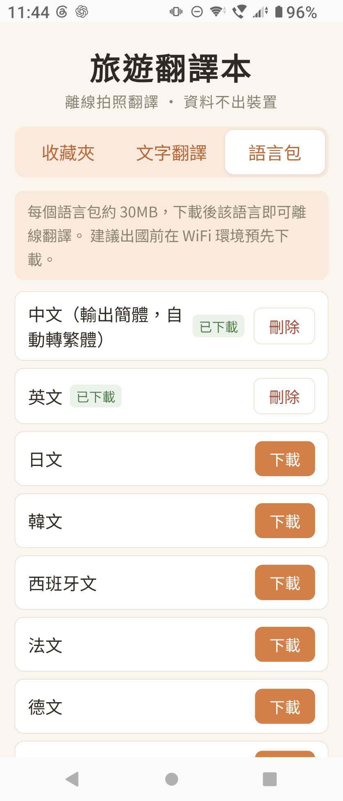
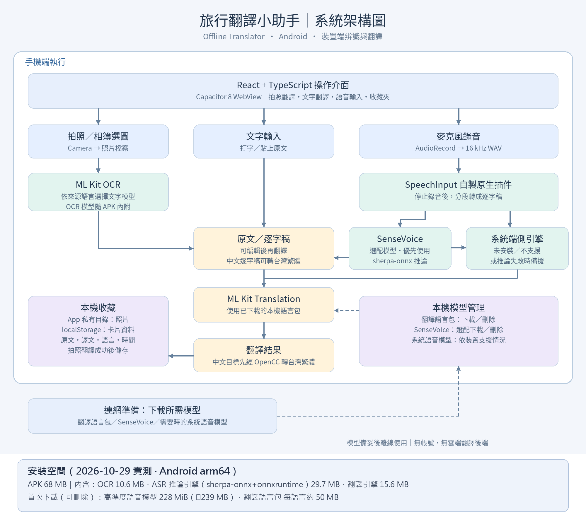
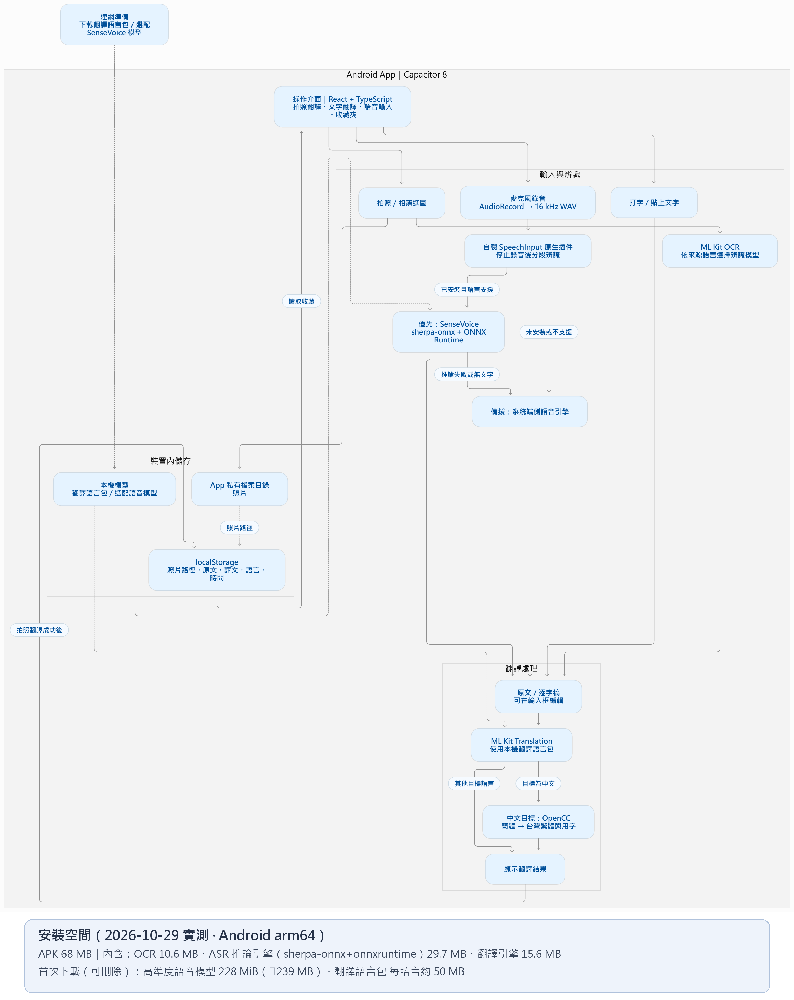

# 離線翻譯 / Offline Translator

完全離線的手機翻譯 app：拍照或輸入文字，翻譯全部在你的裝置上完成。零 API key、零帳號，你的照片、文字與錄音都不離開裝置（**可自行查核**，見[隱私與網路行為](#隱私與網路行為--privacy--network)）。

**應用場景以旅遊為主**——菜單、路標、看板即拍即譯，譯文與照片一起收藏；任何無網路的場合（飛航、國外無漫遊、機密環境）同樣適用。UI 因此採旅遊相簿風格。

A fully offline mobile translation app. Photo or text — everything runs on your device. No API keys, no accounts, and your photos, text and recordings never leave the device (independently verifiable — see Privacy & Network). Travel is its primary use case (menus, signs, notices saved as a photo deck), but it works anywhere without a network.

## 功能 / Features

- **📷 拍照翻譯**：拍下菜單、路標、看板 → 端側 OCR 辨識文字 → 自動翻譯 → 存成旅遊卡片收藏
- **🗺️ 收藏夾**：照片與譯文一起保存，之後可翻看、刪除
- **⌨️ 文字翻譯**：51 種語言互譯，中文輸出自動轉台灣用字繁體（含詞彙轉換，如 software → 軟體）
- **📦 語言包管理**：預先下載旅遊目的地語言包（實測**每個約 50 MB**），刪除釋放空間
- **🎤 語音轉逐字稿**：錄音後端側轉文字（全離線），逐字稿可直接續接翻譯；中文／日／韓／英／粵另可選配**高準度模型**（SenseVoice，**228 MiB**，首次使用時下載，自動加標點；不下載也能用系統語音引擎）

> 💾 安裝空間總表見下方[安裝空間](#安裝空間--storage-footprint)：只裝 App 約 70-90 MB，全配（語音模型＋數個語言包）約 460 MB。

## 截圖 / Screenshots

> 以下為 Android 實機畫面。狀態列的 ✈️ 圖示表示**飛航模式**——辨識、翻譯全部照常運作。

| 收藏夾：拍照翻譯入口 | 文字翻譯（✈️ 飛航模式） |
|---|---|
|  |  |

| 長文翻譯結果（✈️ 飛航模式） | 語言包管理 |
|---|---|
|  |  |

## 架構 / How it works

```
輸入來源
  ├─ 📷 拍照／選圖 ──→ ML Kit Text Recognition v2（端側 OCR）
  ├─ ⌨️ 打字／貼上
  └─ 🎤 錄音（16kHz WAV，AudioRecord 原始未處理收音）
                        │
                        ▼
            端側語音辨識（二選一，自動）
              ├─ 系統 On-Device 引擎（Google，預設；零下載）
              └─ sherpa-onnx + SenseVoice（選配高準度模型，含標點）
                        │
                        ▼
        ML Kit Translation（端側翻譯，Google Translate 離線同款模型）
                        │
                        ▼
        OpenCC cn→twp（簡體 → 台灣用字繁體，含詞彙轉換）

磁碟佔用：⤓ = 首次使用時下載
  APK 內附（68 MB 內）：OCR 模型 10.6 MB ｜ ASR 推論引擎（sherpa-onnx + onnxruntime）29.7 MB ｜ 翻譯引擎 15.6 MB
  ⤓ 選配高準度語音模型　228 MiB（≈ 239 MB）　可刪除
  ⤓ 翻譯語言包　　　　　每語言約 50 MB　　　　可刪除
```

### 架構圖

**總覽**：三個輸入來源、端側 ASR 二選一與備援、端側翻譯與 OpenCC 繁化、本機儲存位置。



**流程細節**：含判斷分支（已裝模型→優先 SenseVoice；未裝／失敗→系統引擎備援）與本機儲存。



> 💾 **圖中未標的安裝空間**：APK 內附 68 MB（OCR 10.6 MB／ASR 推論引擎 29.7 MB／翻譯引擎 15.6 MB）；選配下載高準度語音模型 228 MiB（≈ 239 MB）、翻譯語言包每語言約 50 MB。詳見下方[安裝空間](#安裝空間--storage-footprint)。

- 所有辨識與翻譯**完全在裝置上執行**，飛航模式可用
- 語音走**批次架構**：先錄成 WAV，停止後才把音檔餵給辨識器（連續串流在舊機不可靠）；長錄音自動切段（系統引擎 12 秒、SenseVoice 25 秒）逐段轉寫再接起來
- 收音刻意使用 **`UNPROCESSED` 原始音源**：`VOICE_RECOGNITION` 會被套上 Google 專屬降噪鏈，那條處理過的聲音只有 Google 自家引擎聽得懂，第三方離線模型（SenseVoice／Paraformer）會聽成雜訊
- 高準度模型推論失敗或未安裝時，**自動退回系統端側引擎**（不會讓使用者卡住）
- 唯一的網路行為：首次使用時下載翻譯語言包與（選配的）語音模型；OCR 模型隨 APK 內附，免下載（ML Kit 預設的**使用統計遙測已移除**，見[隱私與網路行為](#隱私與網路行為--privacy--network)）
- 照片存在 app 私有目錄，卡片 metadata 存 localStorage，音訊與文字都不出裝置

## 安裝空間 / Storage footprint

> 實測日期 2026-10-29；APK 為 release 建置（arm64-v8a），裝置為 Sony Xperia 5 IV（Android 14）。

| 項目 | 大小 | 何時佔用 | 可刪除 |
|---|---|---|---|
| **APK**（release） | **68 MB** | 安裝時 | — |
| ├ 原生庫 `.so` | 56 MB | 同上 | — |
| │　├ ML Kit 翻譯 `libtranslate_jni.so` | 15.6 MB | | — |
| │　├ onnxruntime `libonnxruntime.so` | 21.2 MB | 端側 ASR 推論用 | — |
| │　├ sherpa-onnx（jni + c-api + cxx-api） | 8.5 MB | 端側 ASR 推論用 | — |
| │　└ ML Kit OCR `libmlkit_google_ocr_pipeline.so` | 10.6 MB | | — |
| ├ dex 程式碼 | 15 MB | | — |
| └ 網頁資產＋資源（含 OpenCC 詞庫） | 8 MB | | — |
| 系統最佳化產物（dexopt / odex） | 約 10-20 MB | 安裝後由 Android 生成 | — |
| **高準度離線語音模型**（SenseVoice int8，選配） | **228 MiB（≈ 239 MB）** | 首次使用時下載 | ✅ App 內可刪除 |
| **翻譯語言包**（每個語言） | **約 40-60 MB**（實測 en_ja 61／en_ko 50／en_zh 43）| 首次使用該語言時下載 | ✅ App 內可刪除 |
| OCR 模型 | 已含在 APK（10.6 MB） | — | — |

實機總佔用範例：

| 情境 | 佔用 |
|---|---|
| 只裝 App、不下載任何模型 | 約 **70-90 MB** |
| ＋ 高準度語音模型（中文） | 約 **300 MB** |
| ＋ 語音模型 ＋ 3 個翻譯語言包（en_ja / en_ko / en_zh） | 約 **460 MB**（實測：APK 70 MB ＋ 模型 229 MB ＋ 語言包 154 MB） |

兩點補充：
- **不下載高準度語音模型也能用語音**（退回系統端側引擎，零額外下載）——把 228 MiB 留給需要的使用者
- APK 內約 30 MB 是 sherpa-onnx + onnxruntime；若日後以體積優先，可改成 Play Feature Delivery 動態模組或另出「輕量版」口味

## 隱私與網路行為 / Privacy & Network

**不上傳（全部在裝置上處理）**：照片、OCR 文字、翻譯文字、錄音、逐字稿、收藏卡片資料。

**會連線的只有下載模型／語言包**（不上傳任何內容）：

| 連線對象 | 時機 | 必要性 |
|---|---|---|
| Google（ML Kit 翻譯語言包）| 首次使用某語言時下載 | 該語言要用才需要（約 50 MB／語言）|
| HuggingFace（SenseVoice 語音模型）| 選配高準度語音首次使用時下載 | 可不下載，改用系統語音引擎 |
| ~~Google（ML Kit 使用統計遙測）~~ | ~~App 啟動後背景~~ | **已移除**，見下 |

**我們額外移除了 ML Kit 的遙測**：ML Kit 的推論雖然完全在裝置端，但 SDK 預設會把「使用統計」（API 名稱、輸入輸出大小、延遲、裝置／App 資訊、per-install 識別碼）上報到 `firebaselogging.googleapis.com`。本專案在 `AndroidManifest.xml` 以 manifest merge 的 `tools:node="remove"` 移除 `com.google.android.datatransport` 的三個元件，讓遙測管線根本不會初始化（理由與細節寫在該檔註解）。

**你可以自己查核，不必相信我們**：

```bash
# 1) OCR 模型確實內附（不是執行期下載）
unzip -l android/app/build/outputs/apk/debug/app-debug.apk | grep mlkit-google-ocr-models | head

# 2) 原始碼沒有任何上傳呼叫（唯一對外網址是模型／語言包下載）
grep -rnoE "https?://[^\"']+|fetch\(|XMLHttpRequest" src/ android/app/src/main/java/

# 3) 遙測元件已從最終 manifest 移除（以下指令應輸出 0）
grep -c datatransport android/app/build/intermediates/merged_manifest/debug/*/AndroidManifest.xml

# 4) App 只要求兩個權限：RECORD_AUDIO、INTERNET
grep uses-permission android/app/src/main/AndroidManifest.xml
```

`INTERNET` 權限**只用於**上表的下載行為；飛航模式下所有辨識與翻譯照常運作（README 截圖即為飛航模式實測）。

## 技術棧 / Tech Stack

- [Capacitor](https://capacitorjs.com/) 8 + React + TypeScript + Vite
- [@capacitor-mlkit/translation](https://github.com/capawesome-team/capacitor-mlkit)（ML Kit on-device translation）
- [@capacitor-mlkit/text-recognition](https://github.com/capawesome-team/capacitor-mlkit)（ML Kit Text Recognition v2）
- [opencc-js](https://github.com/nk2028/opencc-js)（s2twp：簡體→台灣繁體＋詞彙轉換）
- [sherpa-onnx](https://github.com/k2-fsa/sherpa-onnx)（離線語音辨識推論，Apache-2.0；AAR 不進版控，需先跑 `bash scripts/fetch-deps.sh`）
- Vitest（56 個單元測試）

## 已知限制 / Known Limitations

- **非英文對經英文樞紐**：ML Kit 的非英文翻譯對會經英文中繼（如泰→日 = 泰→英→日），品質打折；主流對（中英、中日）無此問題
- **離線翻譯品質**：等同 Google Translate 離線模式，長句通順度低於雲端 LLM 翻譯
- **OCR script 需選對來源語言**：ML Kit 按文字系統（Latin/中文/日文/韓文）分模型，拍照前請先選對來源語言
- **中文輸出為簡體**：ML Kit 限制，本 app 已用 OpenCC 自動轉台灣繁體
- **系統端側語音辨識品質有限**：內建模型偏向短句／指令、無標點、長段口語易漏字；要好的中文逐字稿請下載選配的 SenseVoice 模型

## 開發 / Development

```bash
npm install
npx cap init   # 首次
npx cap add android
bash scripts/fetch-deps.sh   # 原生相依（sherpa-onnx AAR，49MB，不進版控）
npm run build
npx cap sync android

# 單元測試
npx vitest run

# Android APK（在 android/ 目錄）
gradlew.bat assembleDebug
```

- 需 Node 18+、Android SDK
- 翻譯與 OCR 在瀏覽器（`npm run dev`）預覽時不可用，需實機或模擬器

## 維護狀態 / Maintenance

本專案為**個人專案**：不保證回應 issue 或 PR，也不保證功能請求的實作時程。你可以自由 fork、自行維護（MIT 授權允許）。已知限制見上一節；各項技術取捨的理由都寫在程式碼註解與本文件，方便你自行接手。

## 授權 / License

程式碼：[MIT](LICENSE)

**App 名稱與圖示不在 MIT 授權範圍內**：「旅行翻譯小助手 / Offline Translator」名稱與應用程式圖示（含 launcher icon）為作者保留（All rights reserved）。Fork 或再散布時請更名並更換圖示，以免與原版混淆。

執行時期使用的第三方元件：
- ML Kit（Google，[ML Kit Terms](https://developers.google.com/ml-kit/terms)）
- OpenCC 詞庫（Apache-2.0 / CC BY-SA 3.0，見 [opencc-js](https://github.com/nk2028/opencc-js)）
- [sherpa-onnx](https://github.com/k2-fsa/sherpa-onnx) 執行期（Apache-2.0，以 AAR 形式連結）
- SenseVoice 模型權重（[FunASR Model License v1.1](https://github.com/modelscope/FunASR/blob/main/MODEL_LICENSE)）：由使用者在裝置上自行下載，本專案不散布模型檔
